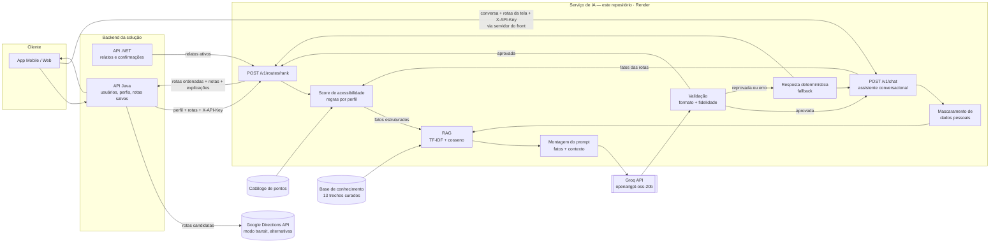

# Rota Leve — Serviço de IA

**Global Solution 2026/2 · CitizenTech · FIAP · 2º ano ADS**
Disciplina: *Disruptive Architectures: IoT, IoB & Generative IA*

O Rota Leve é um app de rotas de transporte público para quem não pode simplesmente "pegar a rota mais rápida": gestantes, pessoas com carrinho de bebê, pessoas idosas, pessoas em cadeira de rodas e pessoas com mobilidade reduzida temporária. Este repositório contém a **funcionalidade de IA** da solução: um serviço que recebe as rotas candidatas, **reordena pelo que importa para o perfil da pessoa**, **explica cada rota em linguagem natural** e **responde dúvidas sobre essas rotas em um assistente conversacional**, com base nos relatos da comunidade.

**Serviço publicado:** https://rota-leve-ai.onrender.com (`/docs` abre o Swagger, `/health` mostra o modelo em uso)

## Integrantes

| RM | Nome completo |
|---|---|
| 561337 | Emanuel ítalo |
| 563557 | Matheus de Almeida Sousa |
| 563734 | Enzo Monteiro Maciel |
| 563811 | Paulo Estalise |
| 562012 | Gabriel Bebé |

## 1. O problema e a funcionalidade de IA

> A Júlia está grávida de 8 meses e precisa ir ao pré-natal. O app comum manda ela pela estação cujo elevador está parado, porque é a rota mais rápida.

**Público beneficiado:** pessoas para quem escada, caminhada longa, ladeira ou espera em pé pesam mais que alguns minutos de viagem.

**O que a IA faz na solução:**

1. **Avalia** cada rota candidata com um score de acessibilidade (0 a 100) específico do perfil, cruzando o trajeto com os relatos colaborativos ativos ("elevador da estação X fora de operação").
2. **Reordena** as rotas: a bloqueada para o perfil vai para o fim, mesmo sendo a mais rápida.
3. **Explica** cada rota em português claro com IA generativa, usando somente os fatos calculados e trechos recuperados de uma base de conhecimento de acessibilidade (RAG).
4. **Conversa** sobre as rotas que estão na tela ("qual tem menos caminhada?", "e se o elevador da Sé estiver quebrado?"), com os mesmos fatos e a mesma base de conhecimento. Não é um chat genérico: fora do tema rotas e acessibilidade, ele recusa.
5. **Valida** toda resposta do modelo antes de mostrá-la; se o modelo errar ou cair, a pessoa recebe uma resposta determinística com os mesmos fatos.

Resultado no cenário de demonstração (dados sintéticos):

| | App comum (mais rápida primeiro) | Rota Leve, perfil gestante |
|---|---|---|
| 1ª opção | Metrô até a Sé, 22 min — elevador fora, 3 lances de escada | Ônibus direto, 31 min — nota 100 |
| Metrô até a Sé | 1ª | 3ª, nota 59, "com ressalvas" |

Para o perfil cadeirante, a mesma rota do metrô aparece em último, marcada como bloqueada.

## 2. Arquitetura



**Legenda:** retângulos são componentes deste serviço; cilindros são dados; o hexágono duplo é o modelo generativo externo. Toda chamada ao modelo passa por **Validação**; nenhuma resposta chega ao cidadão sem ela.

**Fluxo da explicação das rotas** (`POST /v1/routes/rank`)

1. O backend obtém as rotas candidatas na Google Directions API (`mode=transit&alternatives=true`). O roteamento não é refeito aqui.
2. Converte essas rotas para o nosso formato e chama `POST /v1/routes/rank` com o **tipo de perfil** e as rotas.
3. `scoring.py` calcula a nota de cada rota e produz os **fatos estruturados** (distância a pé, elevadores com relato, bloqueio etc.). Esses fatos são a única fonte de verdade.
4. `rag.py` transforma os códigos de problema da rota em uma consulta e recupera até 2 trechos da base de conhecimento.
5. `explain.py` envia fatos + trechos ao modelo generativo, que devolve JSON (`resumo`, `pontos_de_atencao`, `dica`).
6. `grounding.py` confere a resposta. Aprovada: segue com `source: "llm"`. Reprovada, fora do formato ou modelo indisponível: usa o template com `source: "template_fallback"` e o motivo.
7. A resposta volta ordenada, com o detalhamento de cada ponto perdido (`breakdown`).

**Fluxo do assistente conversacional** (`POST /v1/chat`)

1. O app envia a **conversa inteira** (o serviço não guarda histórico), o perfil e as rotas que a pessoa está vendo.
2. `chat.py` mascara e-mail, CPF e telefone nas mensagens antes de qualquer outro passo.
3. `service.route_facts` calcula os fatos de cada rota com o **mesmo score** da tela de resultado, na mesma ordem.
4. `rag.py` busca até 3 trechos da base a partir da última pergunta.
5. O prompt leva perfil, fatos das rotas, trechos, as 8 mensagens anteriores e a pergunta. O modelo devolve JSON (`resposta`, `rotas_citadas`, `fora_do_escopo`).
6. Validação: números só podem vir das rotas, dos trechos ou da própria pessoa; a resposta não pode contradizer bloqueio ou relato de elevador das rotas citadas; ids de rota inexistentes são descartados e ids internos são removidos do texto.
7. Falhou em qualquer etapa: a pessoa recebe o trecho mais relevante da base (ou um aviso honesto), com `source: "template_fallback"` e o motivo.

### Estrutura do repositório

```
render.yaml                Blueprint do Render (deploy)
rota-leve-ai/
  app/
    main.py                API FastAPI (rank, chat, health, rotas de demo)
    service.py             orquestra score -> ordenação -> explicação; fatos para o chat
    scoring.py             score de acessibilidade por perfil
    reports.py             relatos colaborativos: ativo, confirmado, expirado
    rag.py                 recuperação (TF-IDF) sobre a base de conhecimento
    explain.py             explicação das rotas: prompt, chamada ao LLM, fallback
    chat.py                assistente conversacional: mascaramento, prompt, validação, fallback
    grounding.py           validação de fidelidade (números e contradições)
    llm.py                 chamada HTTP à Groq e leitura do JSON de resposta
    catalog.py             catálogo de estações e pontos
  data/                    dados sintéticos + base de conhecimento
  eval/                    casos de avaliação, script e RESULTADOS.md
  tests/                   22 testes automatizados (pytest)
  scripts/demo.py          demonstração por linha de comando
  Dockerfile               mesma API como contêiner
```

## 3. Modelos, tecnologias e justificativas

| Componente | Escolha | Por quê |
|---|---|---|
| **IA generativa** | `openai/gpt-oss-20b` na **Groq**, chamado por HTTP (`LLM_API_KEY`, `LLM_MODEL`) | A tarefa é redigir poucas frases a partir de fatos prontos: um modelo pequeno e rápido basta. A Groq responde em menos de 1 s e tem plano gratuito. Usamos API em vez de modelo local porque o serviço roda no plano free do Render (sem GPU, pouca memória). A chamada é um POST simples no formato da OpenAI; pedimos a resposta em JSON para ler os campos com segurança. Trocar de modelo é só mudar `LLM_MODEL`. |
| **Aprofundamento: RAG básico** | TF-IDF de n-gramas de caracteres + similaridade de cosseno (scikit-learn) | A base é pequena e curada (13 trechos). N-gramas de caracteres toleram flexão e erro de digitação em português ("calsada"). É determinístico e roda offline, o que torna a avaliação reprodutível. Embeddings e banco vetorial só passam a compensar com uma base maior; a interface `Retriever.search` permite a troca sem mexer no resto. O mesmo RAG atende a explicação das rotas e o chat. |
| **Assistente conversacional** | Endpoint stateless que responde sobre as rotas da tela, com fatos do score + RAG | Um chat genérico responderia de memória e poderia inventar elevador funcionando. Aqui o modelo só redige sobre dados que o serviço fornece, e a resposta passa pelo mesmo validador. Stateless porque o app já tem a conversa: o servidor não guarda nada sobre a pessoa. |
| **Score de acessibilidade** | Regras ponderadas por perfil, não um modelo treinado | Não existe base rotulada real de "rota boa/ruim por perfil". Treinar um modelo em dados sintéticos mediria só as regras que usamos para gerar os dados. Regras explícitas são auditáveis (cada ponto perdido tem motivo) e servem de fatos para o LLM. Com uso real e feedback dos usuários, os pesos podem ser aprendidos. |
| **Validação da saída** | Checagem de números e de contradições, com fallback | Em acessibilidade, uma frase errada ("elevador funcionando") tem custo físico para a pessoa. O LLM redige; ele não decide. |
| **API e hospedagem** | FastAPI + Pydantic no Render | Contrato OpenAPI automático (`/docs`) para os times de .NET, Java e Mobile; validação de entrada pronta (perfil vazio, rota inválida ou conversa malformada viram HTTP 422). Render publica direto do GitHub a partir do `render.yaml`. |

**Por que RAG e não só o prompt?** As dicas ("procure um funcionário antes de tentar a escada", "existe o serviço Atende+") não estão nos dados da rota e não devem sair da memória do modelo, que pode inventar leis e serviços. Com RAG, a dica vem de um trecho com fonte registrada, e a resposta devolve os ids usados (`kb_refs`).

**Por que não usamos visão computacional nem deep learning próprio?** A rubrica pede aprofundamento em pelo menos uma técnica. Preferimos uma bem avaliada a três superficiais. A classificação de fotos de calçada é o próximo passo natural (seção 8).

## 4. Dados

| Arquivo | Conteúdo | Origem e preparo |
|---|---|---|
| `data/base_conhecimento.json` | 13 trechos de orientação (direitos, elevador fora, calçada, ladeira, alternativas) com perfis, palavras-chave e fonte | Escritos pelo grupo a partir da Lei 10.048/2000, Estatuto da Pessoa Idosa (Lei 10.741/2003), ABNT NBR 9050 e informações públicas da SPTrans sobre o Atende+. Cada trecho começa pela ação recomendada, para que a primeira frase funcione sozinha como dica. |
| `data/pontos.json` | Estações e pontos com elevador, lances de escada, cobertura, banco | **Sintético.** Usa nomes de locais reais de São Paulo, mas os atributos não refletem a situação real. Em produção: dados abertos (GTFS, SPTrans, Metrô) + cadastro do gestor. |
| `data/relatos.json` | Relatos colaborativos com confirmações e validade | **Sintético**, com horas relativas para a demo não envelhecer. Inclui de propósito um relato não confirmado e um expirado. Em produção: API .NET de relatos. |
| `data/rotas_demo.json` | 4 rotas do cenário da Júlia | **Sintético**, no mesmo formato que o backend envia. |
| `eval/*.json` | Casos de avaliação: perguntas para o RAG, respostas simuladas para o validador, perguntas para o chat | Escritos pelo grupo, com o resultado esperado anotado em cada caso. |

Nenhum dado pessoal real é usado no repositório.

**Regra dos relatos** (`app/reports.py`): ativo enquanto a última confirmação tiver menos de 72 h; com 2 ou mais confirmações é "confirmado" (peso total e pode bloquear a rota); com 1 só é "não confirmado" (meia penalidade, nunca bloqueia, e o texto avisa que é incerto).

## 5. Como executar

Requisitos: Python 3.11+ e, para a IA generativa, uma chave da Groq (https://console.groq.com/keys).

```bash
git clone <url-do-repositorio> && cd Backend-IA/rota-leve-ai
python -m venv .venv && source .venv/bin/activate      # Windows: .venv\Scripts\activate
pip install -r requirements-dev.txt     # produção usa só requirements.txt

cp .env.example .env        # preencha LLM_API_KEY e LLM_MODEL (opcional)
```

O serviço lê variáveis de ambiente. Para carregar o `.env` no terminal:

```bash
export $(grep -v '^#' .env | xargs)                                   # Linux/macOS
Get-Content .env | Where-Object { $_ -match '^[A-Z]' } | ForEach-Object { $k, $v = $_ -split '=', 2; Set-Item "env:$k" $v }   # PowerShell
```

**Sem `LLM_API_KEY` (ou sem `LLM_MODEL`) tudo funciona em modo template** (score, ordenação, RAG, explicação e chat determinísticos), útil para desenvolver e para os testes. Com a chave, as explicações e o chat passam a ser gerados pelo modelo.

```bash
python scripts/demo.py gestante        # demo no terminal (troque o perfil: cadeirante, carrinho, idoso, mobilidade_temporaria)
uvicorn app.main:app --reload          # API em http://localhost:8000  (documentação em /docs)
python -m pytest -q                    # 22 testes
python eval/run_eval.py                # avaliação offline -> eval/RESULTADOS.md
python eval/run_eval.py --live         # idem + avaliação do modelo real (precisa da chave)
```

Com Docker:

```bash
docker build -t rota-leve-ai .
docker run -p 8000:8000 --env-file .env rota-leve-ai
```

### Exemplo: ranqueamento

```bash
curl -s http://localhost:8000/v1/demo/routes > rotas.json
curl -s -X POST http://localhost:8000/v1/routes/rank \
  -H "Content-Type: application/json" \
  -d "{\"profile\": \"gestante\", \"routes\": $(cat rotas.json)}"
```

Resposta (resumida):

```json
{
  "profile": "gestante",
  "routes": [
    {
      "route_id": "r2-onibus-direto",
      "score": 100,
      "label": "recomendada",
      "blocking": false,
      "breakdown": [],
      "explanation": {"resumo": "...", "pontos_de_atencao": [], "dica": "...", "source": "llm", "kb_refs": ["kb-prioridade-lei"]}
    },
    {
      "route_id": "r1-metro-se",
      "score": 59,
      "label": "com_ressalvas",
      "breakdown": [
        {"code": "caminhada_longa", "points": -5, "detail": "600 m de caminhada, acima do limite de 500 m do perfil"},
        {"code": "escadas", "points": -36, "detail": "Estação Sé: elevador fora de operação (relato confirmado), 3 lances de escada"}
      ]
    }
  ],
  "notice": "Pontuação de apoio à decisão baseada em dados colaborativos..."
}
```

### Exemplo: assistente conversacional

```bash
curl -s -X POST http://localhost:8000/v1/chat \
  -H "Content-Type: application/json" \
  -d "{\"profile\": \"gestante\", \"routes\": $(cat rotas.json), \"messages\": [{\"role\": \"user\", \"content\": \"Qual rota tem menos caminhada?\"}]}"
```

```json
{
  "reply": "A rota com menor caminhada é Ônibus 701A direto, com 350 m a pé.",
  "source": "llm",
  "fallback_reason": null,
  "out_of_scope": false,
  "routes_cited": ["r2-onibus-direto"],
  "kb_refs": ["kb-caminhada-longa"],
  "notice": "Assistente com IA: as respostas podem conter erros..."
}
```

Regras da requisição: de 1 a 20 mensagens, `role` só `user` ou `assistant`, até 1000 caracteres cada, e a última precisa ser do usuário. `routes` é opcional, mas sem ele o assistente só responde com a base de conhecimento.

### Integração com o restante da solução

- **Java / .NET:** chamam `POST /v1/routes/rank` enviando o header `X-API-Key` (valor de `SERVICE_API_KEY`). O campo `reports` aceita os relatos ativos vindos da API .NET; sem ele, o serviço usa a base local de demonstração.
- **Front / Mobile:** exibe `score`, `label`, `breakdown` e `explanation` na tela de resultado, com o `notice`. O chat chama `POST /v1/chat` **pelo servidor do front**, para que a `SERVICE_API_KEY` nunca vá para o navegador; mostra o selo "Resposta gerada por IA" quando `source == "llm"` e destaca as rotas de `routes_cited`.
- **Nuvem:** o serviço não guarda estado, então escala horizontalmente. O `Dockerfile` roda o mesmo código como contêiner em outro provedor (Azure Container Apps, App Service).

### Deploy no Render

1. No Render: **New → Blueprint** e selecione o repositório. O `render.yaml` da raiz cria o serviço `rota-leve-ai` (pasta `rota-leve-ai`, Python 3.12, health check em `/health`, deploy a cada push).
2. Em **Environment**, preencha os dois segredos que o Blueprint deixa em branco: `LLM_API_KEY` (chave da Groq) e `LLM_MODEL` (ex.: `openai/gpt-oss-20b`; confira os IDs disponíveis em https://console.groq.com/docs/models). A `SERVICE_API_KEY` é gerada pelo próprio Render: copie o valor para os times de Java/.NET e para o servidor do front.
3. Confira `GET /health`: o campo `ia_generativa` deve mostrar o modelo, não "desativada".

Decisões para produção:
- `POST /v1/routes/rank` e `POST /v1/chat` exigem o header `X-API-Key`: sem isso, qualquer pessoa com a URL gastaria os créditos da Groq. `/health`, `/docs` e `/v1/demo/routes` continuam públicos porque não chamam o modelo.
- Quando o provedor recusa uma chamada, o log registra o motivo devolvido por ele (sem a chave). Foi assim que identificamos que o modelo usado antes, `llama-3.3-70b-versatile`, tinha sido retirado pela Groq.
- Cada ranqueamento explica no máximo 3 rotas, com timeout de 10 s por chamada ao modelo; se o provedor falhar, a resposta sai pelo template e a requisição não fica presa.
- No plano free o serviço dorme após 15 min sem uso e leva cerca de 40 s para acordar (medido em 17/11/2026). Por isso o front deve chamar `/health` ao abrir a tela de resultado, e o serviço deve ser acordado antes de demonstrações.

## 6. Avaliação

Relatório completo e reprodutível: [`rota-leve-ai/eval/RESULTADOS.md`](rota-leve-ai/eval/RESULTADOS.md). Resumo:

| O que foi avaliado | Critério | Resultado |
|---|---|---|
| Recuperação (RAG) | 22 perguntas em linguagem de usuário, trecho esperado anotado | hit@1 86% · hit@3 100% · MRR@3 0,93 |
| Rejeição fora do domínio | 8 perguntas sem relação com o tema devem retornar vazio | 7 de 8 |
| Validador da explicação | 16 respostas simuladas (6 fiéis, 10 infiéis) | precisão 100% · recall 70% |
| Validador do chat | 9 respostas simuladas (4 fiéis, 5 infiéis) | fiéis aceitas 4/4 · infiéis barradas 4/5 (recall 80%) |
| Privacidade no chat | e-mail, CPF e telefone digitados pela pessoa | 3/3 mascarados antes de chegar ao modelo |
| Falhas | LLM fora do ar, JSON inválido, nenhuma rota acessível, entradas inválidas, relato expirado, parada desconhecida | todas seguem com resposta (texto pronto); entradas inválidas retornam 422 — verificado nos testes automáticos (`tests/`) |
| Modelo generativo real | explicações: taxa de aceitação, latência, amostras · chat: 10 perguntas com critério (rota citada, fora do escopo, dado pessoal, injeção) | **[preencher com a seção 4 do RESULTADOS.md após rodar `python eval/run_eval.py --live`]** |

**Como interpretar**

- Os 3 erros de primeira posição do RAG são perguntas com dois assuntos ("elevador parado" + "carrinho de bebê"); o trecho certo vem em 2º, e o serviço usa os 2 primeiros, por isso o hit@3 é o número que importa na prática.
- O limiar de similaridade (0,15) foi escolhido olhando este mesmo conjunto, que é pequeno. É um ajuste inicial, não uma garantia.
- Os validadores nunca barraram uma resposta fiel, e pegaram todo número inventado e toda contradição literal. Eles **não** pegam: estação inventada sem número (caso registrado no relatório do chat), paráfrase de contradição ("já voltou a operar") e suposição sobre a saúde da pessoa.
- A avaliação com o modelo real mede o conjunto: a taxa de aceitação mostra quanto o modelo segue as regras do prompt, e os critérios do chat mostram se ele cita a rota certa, recusa o que está fora do tema e não repete dados pessoais nem cede a "ignore as regras".

## 7. Limitações e uso responsável

**Limitações da IA**

- A nota é tão boa quanto os dados. Relato falso, relato atrasado ou catálogo desatualizado geram nota errada. Por isso toda resposta leva o aviso `notice`, e relatos não confirmados aparecem como incertos.
- Os pesos do score foram definidos pelo grupo por bom senso, sem validação com pessoas dos perfis atendidos nem com especialistas em acessibilidade. Antes de uso real, isso é obrigatório.
- Os validadores de fidelidade são heurísticos (recall de 70% na explicação e 80% no chat, nos nossos testes). Eles reduzem, mas não eliminam, o risco de o modelo afirmar algo falso.
- No chat, a decisão de "fora do escopo" é do modelo, guiada pelo prompt; não há classificador próprio. A seção 4 do relatório mede quantas vezes ele acerta.
- A base de conhecimento é um resumo acadêmico. Leis e serviços mudam; cada trecho tem a fonte para conferência.
- O RAG lexical não entende sinônimos distantes ("abrigo" e "cobertura" funcionam por estarem nas palavras-chave, não por semântica).
- Os dados do repositório são sintéticos: os resultados mostram que o mecanismo funciona, não que as rotas reais de São Paulo estão bem avaliadas.
- O provedor pode retirar o modelo a qualquer momento (aconteceu com o `llama-3.3-70b-versatile`). O ID fica em variável de ambiente e, enquanto não é trocado, o serviço continua respondendo pelo template.
- O sistema não dá orientação médica e os prompts proíbem suposições sobre a saúde da pessoa.

**Privacidade e segurança**

- O perfil de mobilidade pode revelar condição de saúde ou deficiência, que a LGPD trata como dado pessoal sensível. O ranqueamento recebe **apenas o tipo de perfil**, sem nome, e-mail ou identificador do usuário, e é só isso que vai no prompt (há um teste para isso em `tests/test_explain.py`).
- O chat é o único ponto em que texto livre da pessoa vai ao modelo. Antes disso, e-mail, CPF e telefone são mascarados (`tests/test_chat.py`). O mascaramento é por padrão de texto: nome e endereço digitados **não** são removidos, por isso o app avisa para não informar dados pessoais. O servidor não guarda a conversa.
- O texto livre dos relatos, escrito por outros usuários, **não** é enviado ao modelo: só entram no prompt os fatos estruturados (local, tipo, número de confirmações). Isso fecha a principal porta para injeção de prompt indireta.
- Contra injeção direta no chat ("ignore as regras"), o prompt manda tratar perfil, rotas, contexto e histórico como dados, as regras valem mesmo se a pessoa pedir o contrário, e o validador barra respostas que contradigam as rotas. O histórico vem do app e pode ser manipulado; por isso só as 8 mensagens anteriores entram no prompt e nenhuma resposta é aceita sem validação.
- Credenciais só por variável de ambiente; `.env` está no `.gitignore` e o repositório traz apenas `.env.example`. A chave do modelo vai em header, não na URL, e as mensagens de erro não a repetem.
- `POST /v1/routes/rank` e `POST /v1/chat` exigem `X-API-Key`, para que só o backend da solução e o servidor do front os chamem.

## 8. Próximos passos

- Visão computacional: classificar a foto do relato (buraco, degrau, obstáculo) para pré-preencher o tipo e reduzir relatos falsos.
- Trocar o TF-IDF por embeddings multilíngues quando a base crescer, medindo com o mesmo `eval/`.
- Aprender os pesos do score com o feedback "esta rota foi boa para mim?".
- Consumir o evento "elevador quebrado" do RabbitMQ para reavaliar rotas salvas e avisar quem é afetado.
- Mascarar nomes e endereços no chat com um modelo de reconhecimento de entidades, além dos padrões atuais.

## 9. Uso de IA generativa no desenvolvimento

| Ferramenta | Para quê |
|---|---|
| Claude (Anthropic) | Apoio na estruturação do serviço, geração inicial de código, testes e documentação. Todo o conteúdo foi lido, executado e revisado pelo grupo. **[ajustar para refletir o que o grupo realmente fez]** |
| Groq API (`openai/gpt-oss-20b`) | Componente do produto (explicação das rotas e assistente conversacional), não ferramenta de desenvolvimento. |
