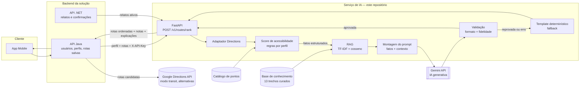

# Rota Leve — Serviço de IA

**Global Solution 2026/2 · CitizenTech · FIAP · 2º ano ADS**
Disciplina: *Disruptive Architectures: IoT, IoB & Generative IA*

O Rota Leve é um app de rotas de transporte público para quem não pode simplesmente "pegar a rota mais rápida": gestantes, pessoas com carrinho de bebê, pessoas idosas, pessoas em cadeira de rodas e pessoas com mobilidade reduzida temporária. Este repositório contém a **funcionalidade de IA** da solução: um serviço que recebe as rotas candidatas, **reordena pelo que importa para o perfil da pessoa** e **explica cada rota em linguagem natural**, com base nos relatos da comunidade.

## Integrantes

| RM | Nome completo | Turma |
|---|---|---|
| 561337 | Emanuel [completar] | 2TDS |
| [RM] | [Nome completo] | [Turma] |
| [RM] | [Nome completo] | [Turma] |
| [RM] | [Nome completo] | [Turma] |
| [RM] | [Nome completo] | [Turma] |

## 1. O problema e a funcionalidade de IA

> A Júlia está grávida de 8 meses e precisa ir ao pré-natal. O app comum manda ela pela estação cujo elevador está parado, porque é a rota mais rápida.

**Público beneficiado:** pessoas para quem escada, caminhada longa, ladeira ou espera em pé pesam mais que alguns minutos de viagem.

**O que a IA faz na solução:**

1. **Avalia** cada rota candidata com um score de acessibilidade (0 a 100) específico do perfil, cruzando o trajeto com os relatos colaborativos ativos ("elevador da estação X fora de operação").
2. **Reordena** as rotas: a bloqueada para o perfil vai para o fim, mesmo sendo a mais rápida.
3. **Explica** cada rota em português claro com IA generativa, usando somente os fatos calculados e trechos recuperados de uma base de conhecimento de acessibilidade (RAG).
4. **Valida** a resposta do modelo antes de mostrá-la; se o modelo errar ou cair, a pessoa recebe uma explicação determinística com os mesmos fatos.

Resultado no cenário de demonstração (dados sintéticos):

| | App comum (mais rápida primeiro) | Rota Leve, perfil gestante |
|---|---|---|
| 1ª opção | Metrô até a Sé, 22 min — elevador fora, 3 lances de escada | Ônibus direto, 31 min — nota 100 |
| Metrô até a Sé | 1ª | 3ª, nota 59, "com ressalvas" |

Para o perfil cadeirante, a mesma rota do metrô aparece em último, marcada como bloqueada.

## 2. Arquitetura



**Fluxo de uma requisição**

1. O backend obtém as rotas candidatas na Google Directions API (`mode=transit&alternatives=true`). O roteamento não é refeito aqui.
2. Chama `POST /v1/routes/rank` com o **tipo de perfil** e as rotas (no formato interno ou a resposta crua da Directions).
3. `scoring.py` calcula a nota de cada rota e produz os **fatos estruturados** (distância a pé, elevadores com relato, bloqueio etc.). Esses fatos são a única fonte de verdade.
4. `rag.py` transforma os códigos de problema da rota em uma consulta e recupera até 2 trechos da base de conhecimento.
5. `explain.py` envia fatos + trechos ao modelo generativo, que devolve JSON (`resumo`, `pontos_de_atencao`, `dica`).
6. `grounding.py` confere a resposta. Aprovada: segue com `source: "llm"`. Reprovada, fora do formato ou modelo indisponível: usa o template com `source: "template_fallback"` e o motivo.
7. A resposta volta ordenada, com o detalhamento de cada ponto perdido (`breakdown`).

### Estrutura do repositório

```
app/
  main.py            API FastAPI (rank, health, rotas de demo)
  service.py         orquestra score -> ordenação -> explicação
  scoring.py         score de acessibilidade por perfil
  reports.py         relatos colaborativos: ativo, confirmado, expirado
  rag.py             recuperação (TF-IDF) sobre a base de conhecimento
  explain.py         prompt, chamada ao LLM, fallback, cache
  grounding.py       validação de fidelidade da resposta do LLM
  llm.py             cliente Gemini (REST) atrás de uma interface
  catalog.py         catálogo de estações e pontos
  adapters/directions.py   converte a resposta da Google Directions API
data/                dados sintéticos + base de conhecimento
eval/                casos de avaliação, script e RESULTADOS.md
tests/               41 testes automatizados (pytest)
scripts/demo.py      demonstração por linha de comando
```

## 3. Modelos, tecnologias e justificativas

| Componente | Escolha | Por quê |
|---|---|---|
| **IA generativa** | Gemini via API REST (`LLM_MODEL`, padrão `gemini-3.6-flash`) | A tarefa é redigir 2 frases a partir de fatos prontos: um modelo rápido e barato basta. API em vez de modelo local porque o serviço roda em contêiner pequeno, sem GPU. O cliente fica atrás de uma interface de um método (`generate_json`), então trocar de provedor é escrever uma classe. |
| **Aprofundamento: RAG básico** | TF-IDF de n-gramas de caracteres + similaridade de cosseno (scikit-learn) | A base é pequena e curada (13 trechos). N-gramas de caracteres toleram flexão e erro de digitação em português ("calsada"). É determinístico e roda offline, o que torna a avaliação reprodutível. Embeddings e banco vetorial só passam a compensar com uma base maior; a interface `Retriever.search` permite a troca sem mexer no resto. |
| **Score de acessibilidade** | Regras ponderadas por perfil, não um modelo treinado | Não existe base rotulada real de "rota boa/ruim por perfil". Treinar um modelo em dados sintéticos mediria só as regras que usamos para gerar os dados. Regras explícitas são auditáveis (cada ponto perdido tem motivo) e servem de fatos para o LLM. Com uso real e feedback dos usuários, os pesos podem ser aprendidos. |
| **Validação da saída** | Checagem de números e de contradições, com fallback | Em acessibilidade, uma frase errada ("elevador funcionando") tem custo físico para a pessoa. O LLM redige; ele não decide. |
| **API** | FastAPI + Pydantic | Contrato OpenAPI automático (`/docs`) para os times de .NET, Java e Mobile; validação de entrada pronta (perfil vazio ou rota inválida viram HTTP 422). |

**Por que RAG e não só o prompt?** As dicas ("procure um funcionário antes de tentar a escada", "existe o serviço Atende+") não estão nos dados da rota e não devem sair da memória do modelo, que pode inventar leis e serviços. Com RAG, a dica vem de um trecho com fonte registrada, e a resposta devolve os ids usados (`kb_refs`).

**Por que não usamos visão computacional nem deep learning próprio?** A rubrica pede aprofundamento em pelo menos uma técnica. Preferimos uma bem avaliada a três superficiais. A classificação de fotos de calçada é o próximo passo natural (seção 8).

## 4. Dados

| Arquivo | Conteúdo | Origem e preparo |
|---|---|---|
| `data/base_conhecimento.json` | 13 trechos de orientação (direitos, elevador fora, calçada, ladeira, alternativas) com perfis, palavras-chave e fonte | Escritos pelo grupo a partir da Lei 10.048/2000, Estatuto da Pessoa Idosa (Lei 10.741/2003), ABNT NBR 9050 e informações públicas da SPTrans sobre o Atende+. Cada trecho começa pela ação recomendada, para que a primeira frase funcione sozinha como dica. |
| `data/pontos.json` | Estações e pontos com elevador, lances de escada, cobertura, banco | **Sintético.** Usa nomes de locais reais de São Paulo, mas os atributos não refletem a situação real. Em produção: dados abertos (GTFS, SPTrans, Metrô) + cadastro do gestor. |
| `data/relatos.json` | Relatos colaborativos com confirmações e validade | **Sintético**, com horas relativas para a demo não envelhecer. Inclui de propósito um relato não confirmado e um expirado. Em produção: API .NET de relatos. |
| `data/rotas_demo.json` | 4 rotas do cenário da Júlia | **Sintético**, no mesmo formato que o adaptador da Directions produz. |
| `tests/fixtures/directions_sample.json` | Exemplo no formato da Google Directions API | Escrito à mão seguindo o esquema da API, para testar o adaptador. |

Nenhum dado pessoal real é usado no repositório.

**Regra dos relatos** (`app/reports.py`): ativo enquanto a última confirmação tiver menos de 72 h; com 2 ou mais confirmações é "confirmado" (peso total e pode bloquear a rota); com 1 só é "não confirmado" (meia penalidade, nunca bloqueia, e o texto avisa que é incerto).

## 5. Como executar

Requisitos: Python 3.11+.

```bash
git clone <url-do-repositorio> && cd rota-leve-ai
python -m venv .venv && source .venv/bin/activate      # Windows: .venv\Scripts\activate
pip install -r requirements.txt

cp .env.example .env        # preencha GEMINI_API_KEY (opcional)
```

O serviço lê variáveis de ambiente. Para carregar o `.env` no terminal:

```bash
export $(grep -v '^#' .env | xargs)        # Linux/macOS
```

**Sem `GEMINI_API_KEY` tudo funciona em modo template** (score, ordenação, RAG e explicação determinística), útil para desenvolver e para os testes. Com a chave, as explicações passam a ser geradas pelo modelo.

```bash
python scripts/demo.py gestante        # demo no terminal (troque o perfil: cadeirante, carrinho, idoso, mobilidade_temporaria)
uvicorn app.main:app --reload          # API em http://localhost:8000  (documentação em /docs)
python -m pytest -q                    # 41 testes
python eval/run_eval.py                # avaliação offline -> eval/RESULTADOS.md
python eval/run_eval.py --live         # idem + avaliação do modelo real (precisa da chave)
```

Com Docker:

```bash
docker build -t rota-leve-ai .
docker run -p 8000:8000 --env-file .env rota-leve-ai
```

### Exemplo de chamada

```bash
curl -s http://localhost:8000/v1/demo/routes > rotas.json
curl -s -X POST http://localhost:8000/v1/routes/rank \
  -H "Content-Type: application/json" \
  -d "{\"profile\": \"gestante\", \"routes\": $(cat rotas.json)}"
```

Resposta (resumida):

```json
{
  "profile": "gestante",
  "routes": [
    {
      "route_id": "r2-onibus-direto",
      "score": 100,
      "label": "recomendada",
      "blocking": false,
      "breakdown": [],
      "explanation": {"resumo": "...", "pontos_de_atencao": [], "dica": "...", "source": "llm", "kb_refs": ["kb-prioridade-lei"]}
    },
    {
      "route_id": "r1-metro-se",
      "score": 59,
      "label": "com_ressalvas",
      "breakdown": [
        {"code": "caminhada_longa", "points": -5, "detail": "600 m de caminhada, acima do limite de 500 m do perfil"},
        {"code": "escadas", "points": -36, "detail": "Estação Sé: elevador fora de operação (relato confirmado), 3 lances de escada"}
      ]
    }
  ],
  "notice": "Pontuação de apoio à decisão baseada em dados colaborativos..."
}
```

Também é possível enviar a resposta crua da Google Directions API no campo `directions` em vez de `routes`.

### Integração com o restante da solução

- **Java / .NET:** chamam `POST /v1/routes/rank` enviando o header `X-API-Key` (valor de `SERVICE_API_KEY`). O campo `reports` aceita os relatos ativos vindos da API .NET; sem ele, o serviço usa a base local de demonstração.
- **Mobile:** exibe `score`, `label`, `breakdown` e `explanation` na tela de resultado. O campo `notice` deve aparecer junto.
- **Nuvem:** o serviço não guarda estado, então escala horizontalmente atrás de um balanceador. Roda como contêiner no Azure Container Apps ou App Service, com `GEMINI_API_KEY` e `SERVICE_API_KEY` como segredos do ambiente (ou Key Vault). O cache de explicações é em memória por instância; com várias réplicas, o passo seguinte é Redis.

## 6. Avaliação

Relatório completo e reprodutível: [`eval/RESULTADOS.md`](eval/RESULTADOS.md). Resumo:

| O que foi avaliado | Critério | Resultado |
|---|---|---|
| Recuperação (RAG) | 22 perguntas em linguagem de usuário, trecho esperado anotado | hit@1 86% · hit@3 100% · MRR@3 0,93 |
| Rejeição fora do domínio | 8 perguntas sem relação com o tema devem retornar vazio | 7 de 8 |
| Consultas geradas pelo sistema | trecho esperado entre os 2 recuperados, por código de problema | 10 de 10 |
| Reordenação | rota que o app comum mostraria primeiro, julgada por perfil | não recomendada em 5 de 5 perfis; bloqueada em 2 |
| Validador de fidelidade | 16 respostas simuladas (6 fiéis, 10 infiéis) | precisão 100% · recall 70% |
| Falhas | LLM fora do ar, JSON inválido, nenhuma rota acessível, entradas inválidas, relato expirado, parada desconhecida | 100% das rotas seguem com explicação; entradas inválidas retornam 422 |
| Modelo generativo real | taxa de aceitação pelo validador, latência, leitura de amostras | **[preencher: rodar `python eval/run_eval.py --live`]** |

**Como interpretar**

- Os 3 erros de primeira posição do RAG são perguntas com dois assuntos ("elevador parado" + "carrinho de bebê"); o trecho certo vem em 2º, e o serviço usa os 2 primeiros, por isso o hit@3 é o número que importa na prática.
- O limiar de similaridade (0,15) foi escolhido olhando este mesmo conjunto, que é pequeno. É um ajuste inicial, não uma garantia.
- O validador nunca barrou uma resposta fiel, e pegou todo número inventado e toda contradição literal. Ele **não** pega: estação inventada sem número, paráfrase de contradição ("já voltou a operar") e suposição sobre a saúde da pessoa. Os três casos estão no relatório.

## 7. Limitações e uso responsável

**Limitações da IA**

- A nota é tão boa quanto os dados. Relato falso, relato atrasado ou catálogo desatualizado geram nota errada. Por isso toda resposta leva o aviso `notice`, e relatos não confirmados aparecem como incertos.
- Os pesos do score foram definidos pelo grupo por bom senso, sem validação com pessoas dos perfis atendidos nem com especialistas em acessibilidade. Antes de uso real, isso é obrigatório.
- O validador de fidelidade é heurístico (recall de 70% no nosso teste). Ele reduz, mas não elimina, o risco de o modelo afirmar algo falso.
- A base de conhecimento é um resumo acadêmico. Leis e serviços mudam; cada trecho tem a fonte para conferência.
- O RAG lexical não entende sinônimos distantes ("abrigo" e "cobertura" funcionam por estarem nas palavras-chave, não por semântica).
- Os dados do repositório são sintéticos: os resultados mostram que o mecanismo funciona, não que as rotas reais de São Paulo estão bem avaliadas.
- O sistema não dá orientação médica e o prompt proíbe suposições sobre a saúde da pessoa.

**Privacidade e segurança**

- O perfil de mobilidade pode revelar condição de saúde ou deficiência, que a LGPD trata como dado pessoal sensível. O serviço recebe **apenas o tipo de perfil**, sem nome, e-mail ou identificador do usuário, e é só isso que vai no prompt enviado ao provedor do modelo (há um teste para isso em `tests/test_explain.py`).
- Credenciais só por variável de ambiente; `.env` está no `.gitignore` e o repositório traz apenas `.env.example`. A chave do modelo vai em header, não na URL, para não aparecer em logs.
- O texto livre dos relatos, escrito por usuários, **não** é enviado ao modelo: só entram no prompt os fatos estruturados (local, tipo, número de confirmações). Isso fecha a principal porta para injeção de prompt. Como segunda barreira, o prompt manda tratar FATOS e CONTEXTO como dados, e o validador barra respostas que fujam deles.
- O endpoint principal aceita autenticação por `X-API-Key` para que só o backend da solução o chame.

## 8. Próximos passos

- Visão computacional: classificar a foto do relato (buraco, degrau, obstáculo) para pré-preencher o tipo e reduzir relatos falsos.
- Trocar o TF-IDF por embeddings multilíngues quando a base crescer, medindo com o mesmo `eval/`.
- Aprender os pesos do score com o feedback "esta rota foi boa para mim?".
- Consumir o evento "elevador quebrado" do RabbitMQ para reavaliar rotas salvas e avisar quem é afetado.

## 9. Uso de IA generativa no desenvolvimento

| Ferramenta | Para quê |
|---|---|
| Claude (Anthropic) | Apoio na estruturação do serviço, geração inicial de código, testes e documentação. Todo o conteúdo foi lido, executado e revisado pelo grupo. **[ajustar para refletir o que o grupo realmente fez]** |
| Gemini API | Componente do produto (explicação das rotas), não ferramenta de desenvolvimento. |
